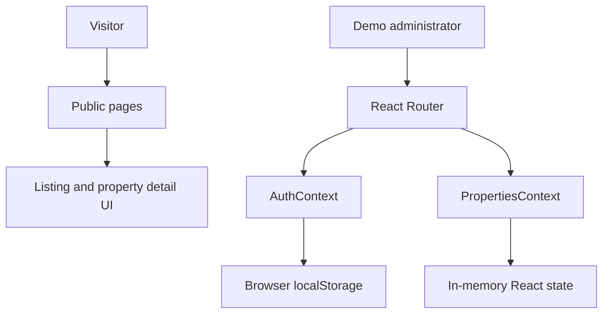

# Arcadia Homes

A real-estate frontend concept for browsing property listings and exploring separate visitor and administration experiences.

**Live demo:** https://arcadia-homes-wvni.vercel.app/

> **Implementation status:** This repository currently uses local application state and browser storage for its demo authentication and property-management interactions. A production backend, server-enforced permissions, and persistent property records are not implemented/verified here. Do not use the client-side role checks as a security boundary.

## Features

- Public landing, about, and contact pages
- Property listing and property detail routes
- Sign-in and sign-up screens
- Admin dashboard screens for properties, agents, messages, and settings
- Client-side route guards and shared authentication/property contexts
- Property create/update/delete/reassignment state handlers
- Dashboard visualisations and reusable UI components

## Stack

- React 19 and TypeScript
- Vite
- React Router
- Tailwind CSS 4
- Axios
- Recharts
- React Hot Toast

## Architecture



The current contexts initialise demo user values from `localStorage` and property records from local data. Property edits are held in React state; refreshing the page is not a persistence guarantee. Axios is installed, but that alone does not establish that the listed workflows are connected to a working API.

## Run locally

Requirements: Node.js and npm.

```bash
npm install
npm run dev
```

## Available checks

```bash
npm run build
npm run lint
```

There is no test script configured in `package.json`. Build and lint have not been executed as part of this repository review, so no passing status is claimed.

## Screenshots

Add screenshots captured from the running application after checking the current deployment and key routes. Screenshots should document the actual UI; they should not be treated as evidence of backend persistence or secure role enforcement.

## Next engineering steps

1. Replace demo authentication with a server-validated session.
2. Connect property, agent, message, and settings workflows to an API and persistent database.
3. Enforce roles and permissions on the server, not only in React route guards.
4. Add integration tests for sign-in, permissions, and property CRUD.
5. Run and record build/lint results in CI.

## Repository

[Source code](https://github.com/NemoCode-3011/arcadia-homes)
